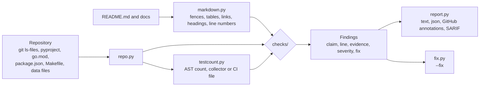

# readme-truth

> **Catches the lie in your README: test counts, versions, commands, links and licence checked against the actual repo.**

[](LICENSE)


<!-- readme-truth: ignore -->
A README makes claims: "424 tests", "Python 3.11+", "run `make train`", "see `docs/setup.md`", "MIT licensed",
a results table. Code moves on and the claims stay where they were. CI passes, because nothing in CI reads the README.

`readme-truth check` turns a README into a list of verifiable claims and checks each one against the
repository. It is deterministic, works offline, needs only the Python standard library, and runs as a CLI
or a GitHub Action.

## Why

A hand audit of 22 public repositories in October 2026 (clone, follow the quickstart, run the tests,
compare every claim) found that 15 had READMEs that no longer matched the code. The drift included test
counts left behind by later PRs, a badge and a paragraph quoting different test counts, a Go minimum older
than `go.mod`, a test command that needed an undeclared plugin, a link to a gitignored directory, and a
framework version one major behind `package.json`. These are the claims this tool checks. The audit is
also its test set: see [Results](#results).

## Quickstart

From a checkout of this repository (about a minute):

```bash
cd readme-truth
python3 -m venv .venv && . .venv/bin/activate
pip install .
readme-truth check path/to/your/repo
```

Output on one of the audited repositories, at the commit before its README was fixed:

<!-- readme-truth: ignore -->
```text
README.md:11: error [test-count] Claimed 415 tests; found 424 (static count of 20 pytest files).
    claim: shields.io/badge/tests-415%20passing
    fix:   [](tests/)
README.md:156: error [test-count] Claimed 381 test functions; found 389 (static count of 20 pytest files).
    claim: 381 test functions
README.md:156: error [test-count] Claimed 19 test files; found 20 (static count of 20 pytest files).
    claim: across 19 files
52 claims found, 50 checked against the repo, 5 findings (5 errors, 0 warnings, 0 notes).
```

## What it checks

| Check | README claim | Checked against |
|---|---|---|
| `test-count` | "N tests", "N passed", "passes N/N", badge text, "N test functions", "across N files" | a static count of the test files (pytest, Go, JS), the real collector with `--collect`, or a CI file |
| `coverage` | "N% coverage", coverage badges, "a N% coverage gate" | a coverage report (coverage.xml, coverage.json, lcov.info, Go profile); gates against `fail_under` / `--cov-fail-under` |
| `version` | "Python 3.11+", "Go 1.26+", "Node 20+", a dependency's major version | `requires-python`, go.mod, `engines.node`, Dockerfile `FROM`, declared dependencies |
| `path` | paths in prose, inline code and layout trees | the tracked files; gitignored paths are reported as such |
| `command` | fenced shell blocks and inline commands | Makefile targets, scripts, `python -m` modules, argparse/click flags (read from the AST, never run), pip extras, npm scripts, Go packages, pytest plugins |
| `link` | relative links and `#anchors`; external URLs with `--check-links` | files and heading slugs (GitHub rules, plus mkdocs `{#id}`) |
| `license` | licence badge or "licensed under ..." | the LICENSE file's text |
| `number-provenance` | numbers in results tables | numbers in committed `json`/`csv`/`tsv`/`md` files, within the rounding shown |
| `contradiction` | the same quantity stated twice with different values | the README itself (test counts, minimum versions) |

Each finding has the claim text, the line, what the README claims, what the repo shows, the evidence, a
severity (`error`, `warning`, `note`) and a suggested fix.

## Usage

```bash
readme-truth check .                                  # README.md
readme-truth check . --docs                           # also top-level *.md and docs/**/*.md
readme-truth check . --format json                    # or: text, github, sarif
readme-truth check . --fail-on warning                # exit 1 on warnings too (default: error)
readme-truth check . --select test-count,version      # or --ignore number-provenance
readme-truth check . --fix                            # rewrite stale test counts and coverage in place
```

Test counts come from a static count by default: test files are parsed and nothing is imported. For the
exact number:

```bash
readme-truth check . --collect                          # runs pytest --collect-only or go test -list
readme-truth check . --test-count-file junit.xml        # JUnit XML, pytest summary output, or an integer
readme-truth check . --test-count-cmd "npx jest --listTests | wc -l"
readme-truth check . --coverage-file coverage.xml
```

`--collect` and `--test-count-cmd` run code from the repository you point them at. The default never does.

Exit codes: `0` no finding at or above `--fail-on`, `1` findings, `2` usage error.

To silence a finding, put `<!-- readme-truth: ignore -->` on its line or the line above. Placed above a
fenced block, it covers the whole block.

`--fix` only rewrites a number when the count is exact and the claim matches a fixed pattern (a badge,
"N passed", "N tests", "N/N"). It never touches approximate claims (a `+` suffix, "about", "over").

## GitHub Action

`action.yml` is a composite action. Every finding becomes an annotation on the README line:

```yaml
- uses: actions/checkout@v7
- uses: shaikn6/readme-truth@v0.1.0   # once published; uses: ./ from a checkout
  with:
    args: --docs --fail-on error
```

A complete workflow, including how to pass the real test count from your test job, is in
[`examples/readme-truth.yml`](examples/readme-truth.yml). This repository runs the action on itself in
[`.github/workflows/ci.yml`](.github/workflows/ci.yml).

## How it works



```text
src/readme_truth/
├── cli.py          # argparse entry point
├── engine.py       # selects the files, runs the checks, applies ignore comments
├── markdown.py     # line-numbered Markdown parsing
├── repo.py         # tracked files, gitignore, pyproject.toml, package.json
├── testcount.py    # static, collected and CI-file test counts
├── report.py       # text, json, github, sarif
├── fix.py          # --fix
└── checks/         # one module per claim type
```

The static pytest count follows pytest's own rules: `testpaths`, `python_files`, `Test*` classes (including
inherited tests and `unittest.TestCase`), literal `parametrize` lists (stacked parametrizations multiply),
parametrized fixtures, and markers deselected in `addopts`. When the parameters are built at run time it
reports a lower bound and only flags claims below it.

## Results

The labelled set comes from the audit above. Each of its 76 discrepancies is marked in or out of scope:
14 can be detected from the repository at the commit before the fix, and 62 cannot by design (runtime
behaviour, timings, environment, wording). The 22 repositories were split before any code was written: 11
for development and 11 held out. The held-out split ran once on a frozen commit. Method, per-item verdicts
and reproduction steps are in [`eval/README.md`](eval/README.md). Every number below is in
[`eval/results/summary.json`](eval/results/summary.json).

| | Dev (tuned on) | Held-out, first run | Held-out, after fixes |
|---|---|---|---|
| In-scope drifts caught at the before commits | 10/10 | 2/4 | 2/4 |
| Claims checked at the after commits | 464 | 981 | 970 |
| False positives at the after commits | 1 (0.22%) | 30 (3.06%) | 12 (1.24%) |
| False positives at warning or error | 0 | 8 | 0 |
| Real drift the fix PRs left behind | 7 | 9 | 9 |

By claim type: test counts 7/7, versions 3/3, commands 1/1, paths 1/2, number provenance 0/1.

On popular third-party projects, run once on fresh sets (click, starlette, pydantic, viper, urfave/cli;
black, rich, typer, chi, logrus), every warning and error in the default README mode was real: 3 of 3.
Examples are rich's stated Python minimum, one release older than its `pyproject.toml`, and two typer
links into the wrong folder.
All 13 notes were wrong. With `--docs`, 1 of 40 sampled findings was real.

The static test count matched the count pytest collected in 9 of 10 audited repositories. In the tenth it
reported a correct lower bound.

## Limitations

- **Most drift is out of reach.** 62 of the 76 audited discrepancies needed the code to run, a clock, the
  machine's environment, another repository, or judgement about wording. A README can be wrong in ways no
  static check sees.
- **Number provenance is weak** in repositories that commit a lot of data. With about 500,000 committed
  numbers, `48%` matches something by chance. That is one held-out miss. Numbers derived when the table
  was written (means, deltas, unit conversions) show up as orphans. Provenance findings are notes only.
- **Notes are noisy.** Files that a tutorial asks the reader to create (`main.py`) are reported as missing
  notes. Notes never fail a build at the default `--fail-on error`.
- **`--docs` on documentation sites is noisy.** Generated API pages, Sphinx cross-references and tutorial
  trees produce false findings. Use it on plain Markdown docs.
- **Test counts:** Go counts top-level tests (subtests make it a lower bound), JS/TS counts are estimates,
  and repos with several suites are only checked when a claim names the language. For exact counts, pass a
  CI file.
- **CLI flags** are checked only for argparse and click scripts in the repository whose options are literal
  strings. Typer, fire and docopt programs are skipped.
- **Coverage percentages** need a coverage report. Without one, only gate claims are checked.
- **The evaluation is small:** 14 in-scope labels, labelled and reviewed by the tool's author, who also read
  the held-out audit text while writing the labels.

## Development

```bash
python3 -m venv .venv && . .venv/bin/activate
pip install -r requirements-dev.txt -e .
pytest --cov                      # 52 tests; CI fails below 90% coverage
ruff check src tests eval && ruff format --check src tests eval
readme-truth check . --docs --fail-on warning
```

See [CHANGELOG.md](CHANGELOG.md) for releases and [SECURITY.md](SECURITY.md) to report a vulnerability.

## License

MIT. See [LICENSE](LICENSE).
